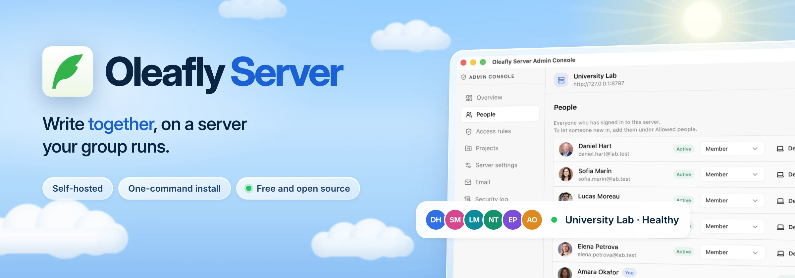
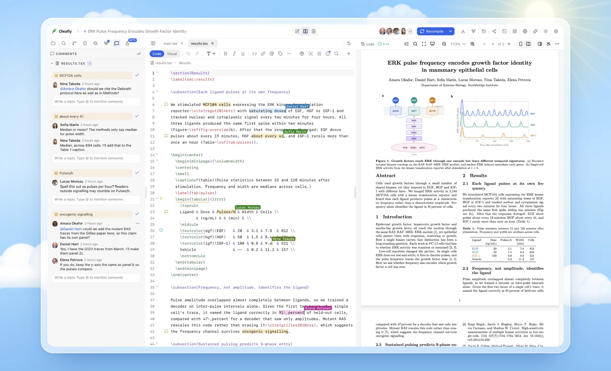
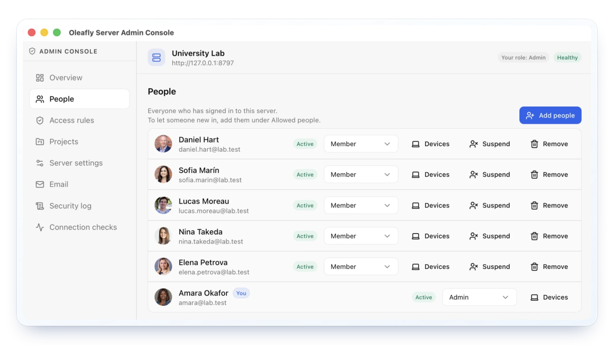

<!-- Images live in .github/readme. Light and dark versions swap with GitHub's theme. -->

<picture>
  <source media="(prefers-color-scheme: dark)" srcset=".github/readme/banner-dark.webp" />
  
</picture>

<div align="center">

**[Install](#install)** &nbsp;·&nbsp;
**[Server guide](https://oleafly.com/docs/collaboration/server/)** &nbsp;·&nbsp;
**[Security](https://oleafly.com/security/)** &nbsp;·&nbsp;
**[Releases](https://github.com/Oleafly/oleafly-server/releases/latest)** &nbsp;·&nbsp;
**[Get help](#get-help)**

</div>

Oleafly Server lets the people in your lab, course or research group write together in [Oleafly](https://oleafly.com) at the same time. Everyone keeps each project as real files on their own computer. The server passes changes, comments and files between them. When someone's connection drops, or they work offline for a while, their changes catch up once they're back.

You run it yourself, on a machine your group or institution controls. If you run a server, this repository is where you get it, update it and report problems.

<picture>
  <source media="(prefers-color-scheme: dark)" srcset=".github/readme/collab-dark.webp" />
  
</picture>

## What the server does

<table>
  <tr>
    <td width="33%" valign="top">
      <br />
      <b><a href="https://oleafly.com/docs/collaboration/">Live co-editing</a></b><br />
      <sub>Named cursors, comments and replies as people type. Everyone keeps real files, and offline edits catch up later.</sub>
    </td>
    <td width="33%" valign="top">
      <br />
      <b><a href="#install">One-command install</a></b><br />
      <sub>One script sets up Docker, HTTPS through Caddy and your settings. Run it again to update.</sub>
    </td>
    <td width="33%" valign="top">
      <br />
      <b><a href="https://oleafly.com/docs/collaboration/server-access/">Your sign-in</a></b><br />
      <sub>Your institution's OpenID Connect provider, GitHub, or a link sent by email.</sub>
    </td>
  </tr>
  <tr>
    <td width="33%" valign="top">
      <br />
      <b>Roles and access rules</b><br />
      <sub>An allowed list, domain rules and four roles from admin to guest. Guests see only the projects they're invited to.</sub>
    </td>
    <td width="33%" valign="top">
      <br />
      <b>Device keys</b><br />
      <sub>Every device has its own key, so a copied token is useless without it. Signing a device out takes effect at once.</sub>
    </td>
    <td width="33%" valign="top">
      <br />
      <b>Signed changes</b><br />
      <sub>The device that makes a change signs it, and the server builds snapshots from that signed log.</sub>
    </td>
  </tr>
  <tr>
    <td width="33%" valign="top">
      <br />
      <b>Security log</b><br />
      <sub>Sign-ins, refused sign-ins, admin actions and device changes, each with the client address.</sub>
    </td>
    <td width="33%" valign="top">
      <br />
      <b><a href="#back-up">Your data, your backups</a></b><br />
      <sub>One data folder, or that folder plus an S3 bucket. Litestream can keep a continuous copy.</sub>
    </td>
    <td width="33%" valign="top">
      <br />
      <b><a href="https://oleafly.com/security/">No outside calls</a></b><br />
      <sub>The server talks only to the sign-in provider you set up. Each release ships a shell-less image and an SBOM.</sub>
    </td>
  </tr>
</table>

## The admin console

Admins run the server from inside Oleafly. The console covers people and their roles, access rules, projects, server settings, email, the security log and connection checks.

<p align="center">
  
</p>

## Install

On a Linux machine with a domain name pointing at it:

```sh
curl -fsSL https://oleafly.com/server/install.sh | sudo sh
```

The installer:

1. Checks the machine: Linux on x86-64 or ARM, and ports 80 and 443 free.
2. Checks for Docker. If it is missing, it asks before installing it.
3. Asks for your domain, a name for the server and how people sign in. It also offers to set up email and to keep files in an S3 bucket.
4. Writes its files to `/opt/oleafly-server`, with your settings in `.env` readable only by root. It never overwrites an existing `.env`.
5. Starts the server from the published image, with Caddy in front for HTTPS.
6. Waits until the server answers, then prints the setup code and what to do next.

To finish, open Oleafly, choose **Add server**, enter your server's address and use the setup code to become its first admin.

If your institution doesn't allow piping a script into a shell, download `install.sh` and `SHA256SUMS` from the [latest release](https://github.com/Oleafly/oleafly-server/releases/latest), check the script with `sha256sum --check --ignore-missing SHA256SUMS`, read it and run it with `sudo sh install.sh`. Or use one of the other ways below.

## What you need

- A Linux machine that stays on. A small virtual machine is enough to start. Keep an eye on its memory and disk as your projects grow.
- A domain name, such as `collab.example.org`, with a DNS record pointing at the machine, and ports 80 and 443 open to it.
- A way for people to sign in: a GitHub OAuth app, or your institution's sign-in (OpenID Connect). An email account the server can send from is optional. With it, the server can send invitations and notifications.

## Other ways to run it

| Option | When to use it |
| --- | --- |
| Docker Compose by hand | Download `docker-compose.yml`, `Caddyfile`, `litestream.yml`, `env.example` and `SHA256SUMS` from the [latest release](https://github.com/Oleafly/oleafly-server/releases/latest) and check them. Rename `env.example` to `.env`, fill it in, then run `docker compose up -d`. |
| Coolify | You already run a Coolify server. |
| Render or Railway | You'd rather pay a hosting service than look after a machine. |
| Linux without Docker | A university machine where you can't use Docker. Each server release on the [Oleafly releases page](https://github.com/Oleafly/Oleafly/releases) includes a single Linux program for x86-64 and ARM. |

The [server guide](https://oleafly.com/docs/collaboration/server/) walks through each one.

## Update

Run the installer again with `update`:

```sh
curl -fsSL https://oleafly.com/server/install.sh | sudo sh -s -- update
```

It downloads the new release's files and image, keeps your `.env`, restarts the server and waits until it answers. People connected at the time reconnect by themselves. It never moves a server to an older release.

To check on the server, run `sudo sh /opt/oleafly-server/install.sh status`. To remove it, run the same command with `uninstall`. Your data stays unless you type `delete` when it asks.

## Back up

Everything the server keeps lives in one data folder, or in that folder plus an S3 bucket if you store files in a bucket. [Storage, backups and limits](https://oleafly.com/docs/collaboration/server-operations/) covers backups, a restore drill and continuous copies with Litestream.

## What the server keeps and who can read it

The server keeps accounts, signed-in devices, a security log, server settings and every shared project with its full history.

Projects are not encrypted on the server. Anyone who can read the data folder, the machine's disk or your backups can read every project stored there. Inside Oleafly the rules are stricter: no server role, admin included, can open a project unless its owner added them. Every member's computer also keeps a full copy of each project shared with them.

[Sign-in and access](https://oleafly.com/docs/collaboration/server-access/) covers sign-in providers, access rules, guests and the admin console. The [security page](https://oleafly.com/security/) explains how the server protects sign-ins and changes.

## Get help

- Something went wrong while installing or updating: [open an install problem](https://github.com/Oleafly/oleafly-server/issues/new/choose).
- The server misbehaves once it runs: open a server bug, with the server version and what you saw.
- Not sure how to set something up: ask a question in the issues.

Please don't report security problems in public issues. Follow the [security policy](https://github.com/Oleafly/Oleafly/security/policy) instead.

## Source code

The server's source code lives in the [Oleafly repository](https://github.com/Oleafly/Oleafly), in `crates/oleafly-server`, next to the desktop app it works with. Releases built from it are published here.

## License

Oleafly Server is free software under the [GNU Affero General Public License v3.0](LICENSE).
